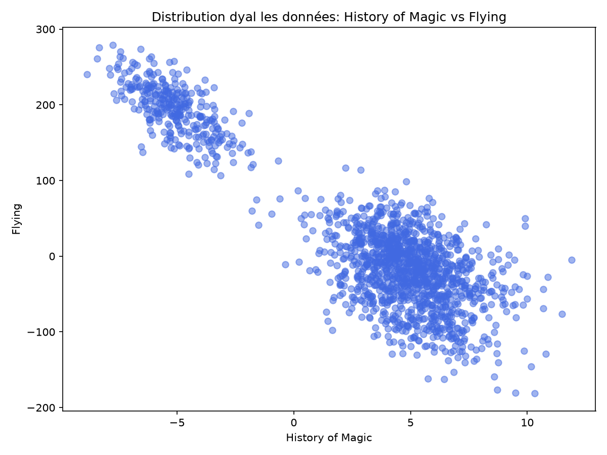
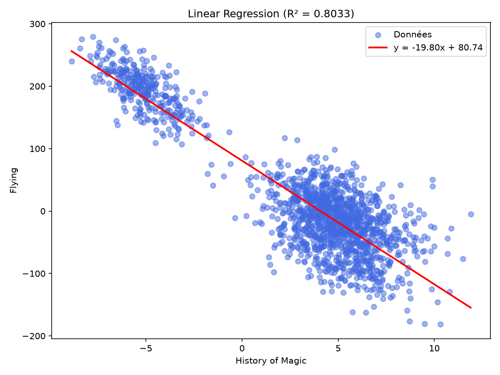

# Linear Regression from Scratch

Implémentation d'une régression linéaire (OLS) en Python pur, **sans** `numpy.polyfit` ni aucune librairie de machine learning. Le modèle est appliqué sur le dataset Hogwarts (`dataset_train.csv`).

## 📊 Objectif

Prédire la colonne **Flying** à partir de la colonne **History of Magic** en utilisant une droite de régression linéaire :

```
y = a*x + b
```

## 🗂️ Structure du projet

```
.
├── linear_regression.py       # Script principal
├── dataset_train.csv          # Données d'entraînement
├── dataset_test.csv           # Données de test
├── plot_1_distribution.png    # Distribution des données (avant régression)
├── plot_2_regression_line.png # Données + droite de régression
└── README.md
```

## ⚙️ Fonctionnement

1. **Chargement des données** : lecture du CSV, extraction des deux colonnes concernées.
2. **Nettoyage (cleaning)** : suppression des lignes où une valeur est manquante ou invalide (`dropna`).
3. **Calcul de la régression** : application de la formule des moindres carrés (Ordinary Least Squares) :

```
a = Σ((x - x̄)(y - ȳ)) / Σ((x - x̄)²)
b = ȳ - a*x̄
```

4. **Prédiction** : `predict(x) = a*x + b`

## ▶️ Utilisation

```bash
python3 linear_regression.py
```

Sortie attendue :

```
y = -19.8042x + 80.7399
predict(5.23) = -22.8572
```

## 📈 Résultats

**Distribution des données :**



**Droite de régression obtenue :**



| Métrique | Valeur |
|---|---|
| a (slope) | -19.80 |
| b (intercept) | 80.74 |
| R² | 0.8033 |

## 🛠️ Technologies

- Python 3 (standard library uniquement : `csv`)
- Aucune dépendance externe pour le calcul (`matplotlib` utilisé seulement pour les graphiques)

## ✍️ Auteur

Safae El Hamri
